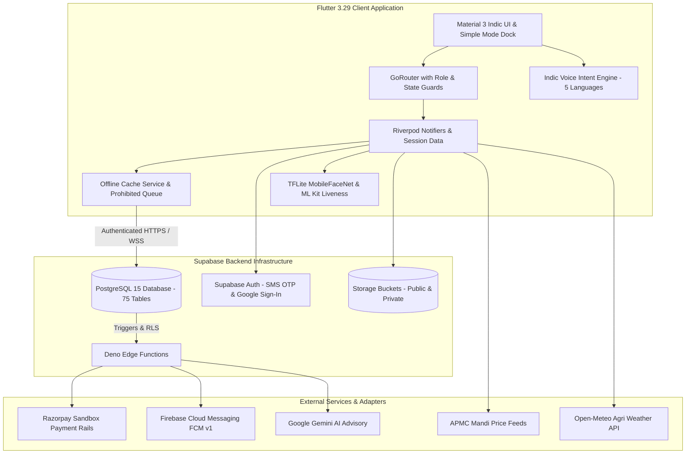

# UdyogaSethu (ಉದ್ಯೋಗಸೇತು)

[](https://github.com/udyoga-sethu/udyoga-sethu/actions/workflows/ci.yml)
[](https://flutter.dev)
[](https://supabase.com)
[]()

> **A Multilingual, Trust-Centric Platform for Informal Workers, Job Providers, Farmers, and Direct Local Commerce in India.**

---

## 1. Project Overview & Architecture

UdyogaSethu empowers informal daily-wage earners, service providers, and local farmers through verifiable digital credentials, double-entry escrow wages, on-device biometric check-in, APMC mandi commerce, and multilingual voice assistance.



---

## 2. Environment Variables & Secret Configuration

The repository strictly enforces credential isolation. **Secrets must never be committed to Git or embedded in the Flutter client binary.**

| Variable Name | Target Environment | Scope | Description |
| :--- | :--- | :--- | :--- |
| `SUPABASE_URL` | Client & Server | Public | Supabase project API gateway endpoint |
| `SUPABASE_ANON_KEY` | Client (`env.json`) | Public | Safe publishable anonymous key for client RLS requests |
| `SUPABASE_SERVICE_ROLE_KEY` | Server (Edge Functions) | **SECRET** | Supabase service-role admin key; **NEVER in Flutter** |
| `GOOGLE_WEB_CLIENT_ID` | Client (`env.json`) | Public | Google OAuth 2.0 Web Client ID for Google Sign-In |
| `RAZORPAY_KEY_ID` | Client / Server | Public | Razorpay Public Key (`rzp_test_...`) |
| `RAZORPAY_KEY_SECRET` | Server (Edge Functions) | **SECRET** | Razorpay Secret for webhook HMAC verification |
| `FIREBASE_SERVICE_ACCOUNT` | Server (Edge Functions) | **SECRET** | Service Account JSON for FCM HTTP v1 push dispatch |
| `GEMINI_API_KEY` | Server (Edge Functions) | **SECRET** | Google Gemini Generative AI API key |
| `WHATSAPP_CLOUD_API_TOKEN` | Server (Edge Functions) | **SECRET** | Meta WhatsApp Business Cloud API Access Token |
| `WHATSAPP_PHONE_NUMBER_ID` | Server (Edge Functions) | **SECRET** | Meta Registered WhatsApp Business Phone Number ID |
| `DEMO_BUILD` | Client (`env.json`) | Optional | Set to `"true"` to enable evaluator demo shortcuts |

### Setting Up `env.json` (Client-Side)

Create `env.json` at the root of the project:

```json
{
  "SUPABASE_URL": "https://your-supabase-project.supabase.co",
  "SUPABASE_ANON_KEY": "your-supabase-anon-key-here",
  "GOOGLE_WEB_CLIENT_ID": "your-google-oauth-client-id.apps.googleusercontent.com",
  "RAZORPAY_KEY_ID": "rzp_test_your_razorpay_key_id",
  "DEMO_BUILD": "false"
}
```

---

## 3. Setup from Scratch

### Prerequisites
* Flutter SDK `3.29.0` or latest stable (`flutter --version`)
* Java Development Kit (JDK 17)
* Dart SDK `^3.13.2`
* Supabase CLI (`supabase --version`)
* PostgreSQL client utilities (`psql`)

### Step 1: Clone & Install Dependencies
```bash
git clone https://github.com/udyoga-sethu/udyoga-sethu.git
cd "udyoga-sethu"
flutter pub get
```

### Step 2: Supabase Migrations
Apply all numbered SQL migrations in `supabase/migrations`:
```bash
# Using Supabase CLI locally:
supabase start
supabase db reset

# Or against remote Supabase project:
supabase db push
```

### Step 3: Deploy Edge Functions
Deploy serverless functions with required secret environment variables:
```bash
supabase functions deploy payment-create-order
supabase functions deploy payment-webhook --no-verify-jwt
supabase functions deploy face-enroll
supabase functions deploy kyc-callback --no-verify-jwt
```

---

## 4. Running Tests & Verifications

All test suites can be executed repeatedly from a clean checkout:

### 1. Flutter Static Analysis (Zero-Warnings Policy)
```bash
flutter analyze
```

### 2. Localization Completeness Check (8 Languages, 1,273 Keys)
```bash
dart run tool/check_l10n.dart
```

### 3. Secret & Credential Scanning
```bash
dart run tool/secret_scan.dart
```

### 4. Backend SQL Test Suites
```bash
# Windows
tool\test_backend.bat

# Linux / macOS / CI
chmod +x tool/test_backend.sh
./tool/test_backend.sh
```

### 5. Automated Unit & Widget Test Suite
```bash
flutter test test/p10_critical_unit_tests.dart
flutter test test/p10_critical_widget_tests.dart
flutter test test/app_critical_flow_test.dart
```

### 6. Zero Layout Overflow Matrix Test
```bash
# Windows
tool\check_overflow.bat

# Linux / macOS
chmod +x tool/check_overflow.sh
./tool/check_overflow.sh
```

---

## 5. Building for Android Release

### Configure Keystore Signing (Local Only)
1. Copy the example configuration:
   ```bash
   cp android/key.properties.example android/key.properties
   ```
2. Generate an upload keystore if not already created:
   ```bash
   keytool -genkey -v -keystore android/app/upload-keystore.jks -keyalg RSA -keysize 2048 -validity 10000 -alias upload
   ```
3. Update `android/key.properties` with your passwords and keystore path. `key.properties` and keystore files are strictly ignored by Git.

### Build Release APK & Android App Bundle (AAB)
```bash
# Build standalone release APK
flutter build apk --release --dart-define-from-file=env.json

# Build optimized Google Play App Bundle (AAB)
flutter build appbundle --release --dart-define-from-file=env.json
```

Outputs:
* Release APK: `build/app/outputs/flutter-apk/app-release.apk`
* Release AAB: `build/app/outputs/bundle/release/app-release.aab`

---

## 6. Demo Personas & Safe State Reset

For rapid evaluator walkthroughs, pre-seeded accounts and 5 canonical end-to-end scenarios are available in demo builds:

| Role Persona | Test Phone | Initial Balance | Highlights |
| :--- | :--- | :--- | :--- |
| **Worker (Informal)** | `+91 99000 00001` | ₹1,500.00 | Accepted jobs, dynamic QR check-in, instant wage credit |
| **Job Provider** | `+91 99000 00002` | ₹5,000.00 | Search discovery, upfront escrow lock, job completion rating |
| **Farmer (Karnataka)**| `+91 99000 00003` | ₹10,000.00 | Produce listing, Mandi price bands, delivery slots |
| **Worker (Student)** | `+91 99000 00004` | ₹800.00 | Verified student badge, flexible gig shifts |
| **Worker (Part-Time)**| `+91 99000 00005` | ₹1,200.00 | Weekend shifts, micro-credential certifications |

### Resetting Demo Data
To reset test accounts, tomato inventories (500 kg), and wallet balances back to baseline:
1. Tap **Reset Demo State** in `DemoLauncherSheet`.
2. Or call the server-authoritative RPC:
   ```sql
   SELECT public.reset_demo('DEMO_RESET_UDYOGASETHU_2026');
   ```

---

## 7. Known Limitations & Technical Disclosures

* **Simulated Escrow & Insurance**: Escrow-style fund holding runs on Razorpay sandbox test rails. The platform is not a licensed RBI-regulated escrow NBFC/bank, nor does it issue underwritten insurance policies.
* **Emergency SOS**: In-app notifications and SMS intents are dispatched to pre-configured contacts; the app does **not** dial 112 police dispatch automatically.
* **eKYC Sandbox**: Verification uses `MockProvider` and does not connect to live UIDAI production endpoints. Raw Aadhaar numbers are never stored.
* **Telephony Masking**: Uses simulated audio proxies when live Twilio or Exotel telephony provider credentials are not configured.
* **Admin Console Scope**: The Admin moderation and dispute resolution console is built in a separate web/desktop workspace and is outside the scope of this mobile client.
