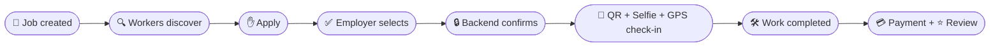
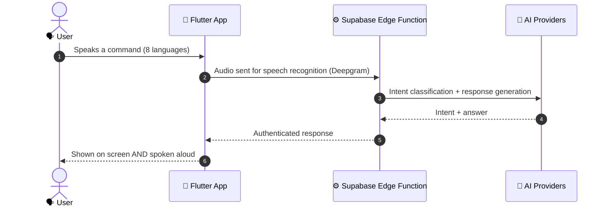
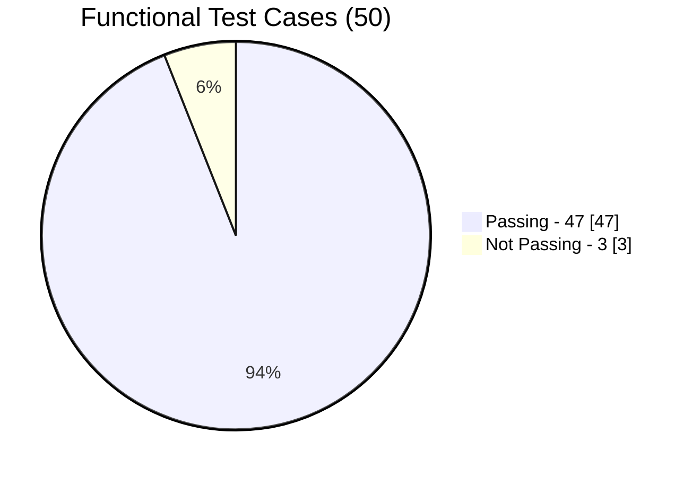

<div align="center">


<a href="https://github.com/chethankp365/UdyogaSethu">

</a>

<br/>

[](https://flutter.dev/)
[](https://supabase.com/)
[](https://postgis.net/)
[](https://spring.io/projects/spring-boot)
[](https://firebase.google.com/)


**[✨ Features](#-what-it-does) · [📱 App Tour](#-see-it-in-action) · [🔐 Trust Engine](#-the-trust-engine) · [🎙️ Voice](#-the-voice-layer) · [🏗️ Architecture](#-architecture) · [🚀 Run It](#-run-it-locally)**

</div>

---

## 🌉 The Idea in One Breath

> *An electrician in one app. A farmer in another. A customer juggling both.*
> *UdyogaSethu puts them on **one bridge**.*

**Udyoga** (उद्योग) means *work*. **Sethu** (सेतु) means *bridge*.

India's informal economy runs on electricians, plumbers, drivers, domestic workers, daily-wage workers and small farmers. Most still find work through word of mouth, depend on intermediaries, and are scattered across disconnected platforms.

UdyogaSethu is a **voice-first digital ecosystem** that brings it all together:

<table>
<tr>
<td width="50%" valign="top">

### 💼 Marketplace 1
## Work & Services
Workers discover nearby jobs, apply, get hired and get booked by customers.

</td>
<td width="50%" valign="top">

### 🌾 Marketplace 2
## Farm to Consumer
Farmers list produce and sell directly to customers, with delivery or pickup.

</td>
</tr>
</table>

<div align="center">

**🔗 Both share one identity · one verification system · one wallet 🔗**

</div>


## 🧭 Why This Exists

| 😣 The reality today | 🌉 The UdyogaSethu answer |
|---|---|
| Hard to find nearby work | 📍 Location-based job discovery |
| Middlemen take a cut | 🤝 Direct worker ↔ customer ↔ farmer connections |
| Apps are hard to use | 🗣️ Voice assistant in **8 languages** |
| Strangers are hard to trust | 🛡️ Verification, attendance evidence, ratings |
| Payments are scattered | 💳 One wallet, server-verified transactions |
| Separate apps for every need | 🪪 One account across both marketplaces |
| Farmers struggle to find buyers | 🌾 Direct farmer-to-consumer marketplace |

> **Our objective:** an accessible, trustworthy and integrated platform that makes work, local services and agricultural markets easier to reach.


## ⚡ What It Does

<details open>
<summary><b>💼 Employment Marketplace</b></summary>
<br/>

- Create and manage worker profiles
- Discover nearby jobs with descriptions, locations and pay details
- Apply, then track application and job status
- **Duplicate applications blocked at the database level**
- Digital job tickets for accepted jobs

</details>

<details open>
<summary><b>🛠️ Local Service Marketplace</b></summary>
<br/>

- Find electricians, plumbers, drivers and more near you
- Send booking requests and track their status
- View verified worker information
- Build trust through ratings and reviews

</details>

<details open>
<summary><b>🌾 Farmer-to-Consumer Marketplace</b></summary>
<br/>

- Create produce listings with prices and quantities
- Update or pause listings anytime
- Customers discover nearby produce, add to cart, order for delivery or pickup
- Track fulfilment and handover

</details>

<details>
<summary><b>📍 Location Intelligence (GPS + PostGIS)</b></summary>
<br/>

Nearby jobs · worker search · proximity-based service discovery · nearby produce · geographic distance calculations

</details>

<details>
<summary><b>💳 Wallet & Payments</b></summary>
<br/>

Wallet balance · add money · transaction records · payment verification · server-side order validation · Razorpay (**sandbox mode only**)

</details>

<details>
<summary><b>🌦️ Agri Intelligence</b></summary>
<br/>

Mandi prices · weather advisories · data from external sources · **cached fallback** when external services are down

</details>

<details>
<summary><b>🔔 Notifications & 🖥️ Admin Dashboard</b></summary>
<br/>

**Push notifications** via Firebase Cloud Messaging bring users back to the app, where the latest *backend-confirmed* data is fetched.

**Admin portal** (Java + Spring Boot + Vaadin): user management and verification, job and produce moderation, payment monitoring, dispute handling and audit logs.

</details>


## 📱 See It in Action

### 👷 Workers: find jobs, manage work

<table>
<tr>
<td width="50%" align="center">

**Worker Dashboard**


*Opportunities and worker services at a glance.*

</td>
<td width="50%" align="center">

**Nearby Jobs**


*Location-based job discovery on a map.*

</td>
</tr>
<tr>
<td width="50%" align="center">

**Digital Job Ticket**


*A QR-based ticket for every accepted job.*

</td>
<td width="50%" align="center">

**Worker Credentials**


*Skills, languages and verification status.*

</td>
</tr>
</table>

### 🌾 Farmers: manage and sell produce

<table>
<tr>
<td width="50%" align="center">

**Farmer Dashboard**


*Weather, mandi prices and farm info.*

</td>
<td width="50%" align="center">

**Produce Listings**


*Control prices and stock.*

</td>
</tr>
<tr>
<td width="50%" align="center">

**Farmer Profile**


*Profile and farm details.*

</td>
<td width="50%" align="center">

**Farm Produce Marketplace**


*Fresh produce from nearby farms.*

</td>
</tr>
</table>

### 🛒 Customers: one home for services and produce

<div align="center">


*Local workers, services and produce, all in one place.*

</div>

### 🎬 Interactive Tour

<div align="center">


</div>

<details>
<summary><b>▶️ Prefer a GIF? Open the walkthrough</b></summary>

<div align="center">


</div>

</details>


## 🔐 The Trust Engine

Strangers meeting for work need proof, not promises. UdyogaSethu asks for **three independent pieces of evidence** before attendance counts.

<div align="center">

| 🎫 **QR** | 🤳 **Selfie** | 📍 **GPS** |
|:---:|:---:|:---:|
| Confirms the digital job ticket | Face-based identity evidence | Confirms the worker's location |

### ⬇️ the backend evaluates all three ⬇️

## ✅ Attendance accepted

</div>


Additional trust layers: identity verification workflows · worker credentials · ratings and reviews · evidence-based dispute management.

### 🔄 The Job Lifecycle




### 🧱 The Golden Rule: *the backend is the truth*

> A button tap is **not** proof. A notification is **not** proof.
> The app always refreshes and shows the state **confirmed by the backend**.

The farm order flow follows the same discipline:

```text
🌱 Listing  →  🛒 Cart  →  📦 Order  →  🚚 Fulfilment  →  🤝 Handover  →  💳 Payment  →  ⭐ Review
```


## 🎙️ The Voice Layer

Not everyone wants to hunt through menus. **Just say what you need.**




| Layer | Technology |
|---|---|
| 👂 Speech recognition | Deepgram |
| 🧠 Primary language model | Groq |
| 🔮 Multimodal / complex reasoning | Google Gemini |
| 🛟 Fallback provider | OpenRouter |
| 🎯 Intent classification | Hugging Face |
| 🛡️ Orchestration | Supabase Edge Functions (authenticated) |

### 🧷 Voice safety rails

- 🧭 Navigation limited to an **allow-list** of real app screens
- 👀 Every answer is displayed *and* spoken
- 🚫 A spoken command is **never** treated as a completed database action until the backend confirms it
- 🔁 Graceful fallbacks for permission failures, unsupported languages and network errors


## 🏗️ Architecture

```text
 ┌──────────────────────────┐        ┌──────────────────────────────┐
 │   📱 Flutter Android App │        │  🖥️ Admin Portal             │
 │  Workers·Farmers·Customers│       │  Java 21 · Spring Boot · Vaadin│
 │  GPS · Camera · QR · Voice│       └──────────────┬───────────────┘
 └─────────────┬────────────┘                       │
               │                                    │
               ▼                                    ▼
 ┌────────────────────────────────────────────────────────────────┐
 │                    ☁️  SUPABASE  (shared backend)               │
 │  Auth · Storage · Realtime · Edge Functions (TypeScript/Deno)  │
 │  ┌──────────────────────────────────────────────────────────┐  │
 │  │  🐘 PostgreSQL + PostGIS   ·   🔒 Row Level Security     │  │
 │  └──────────────────────────────────────────────────────────┘  │
 └───────┬──────────────┬──────────────┬──────────────┬───────────┘
         ▼              ▼              ▼              ▼
     🧠 Groq /       🎤 Deepgram    💳 Razorpay    🔔 Firebase
   Gemini/OpenRouter                 (sandbox)        FCM
```


### 🧠 Four design principles

| Principle | What it means |
|---|---|
| 🎯 **Single source of truth** | Important states are validated and stored by the backend |
| 🔐 **Secure by default** | Row Level Security and server-side validation guard sensitive actions |
| 🧩 **Separation of concerns** | Mobile app and admin portal use separate configs and access controls |
| 🔌 **Controlled integrations** | External services are reached only through backend workflows |


## 🧰 Technology Stack

| Category | Technologies |
|---|---|
| 📱 **Mobile** | Flutter, Dart, Riverpod (state), GoRouter (navigation) |
| ☁️ **Backend** | Supabase, Supabase Auth, Edge Functions (TypeScript, Deno) |
| 🗄️ **Database** | PostgreSQL, PostGIS |
| 🖥️ **Admin portal** | Java 21, Spring Boot 3.3.5, Vaadin Flow 24.4.12, Spring Security |
| 🛡️ **Security** | PostgreSQL RLS, Spring Security |
| 🎙️ **Voice & AI** | Deepgram, Groq, Google Gemini, OpenRouter, Hugging Face |
| 🗺️ **Maps & Location** | Flutter Map, OpenStreetMap-compatible tiles, Geolocator |
| 📷 **Camera & Scanning** | Camera, Google ML Kit, mobile_scanner, qr_flutter |
| 💳 **Payments** | Razorpay Flutter (sandbox) |
| 🔔 **Notifications** | Firebase Cloud Messaging |
| 🌦️ **Agri data** | Open-Meteo, Agmarknet, data.gov.in |
| 🏗️ **Build** | Gradle, R8, ProGuard, Maven, Flutter Pub |


## 🔒 Security Hardening

A recent mobile security review covered **eight areas**:

| 🛡️ Area | ✅ Improvement |
|---|---|
| Biometric data | Face embeddings, cached photo bytes and stored face data cleared on logout |
| Suspended accounts | Cached session state cleared to prevent offline session bypass |
| Android | Backups and cleartext network traffic disabled |
| Logging | Debug logging silenced in release builds |
| Wallet | Transaction limits and balance validation |
| Edge Functions | Security-related HTTP response headers |
| Dependencies | Packages updated, retracted release addressed |
| Git hygiene | Expanded ignore rules, project-specific values removed from docs and examples |

<div align="center">

| 🔍 Analyzer issues | 🗝️ Files secret-scanned | 🚨 Secrets found | 🧪 Security & widget tests | 📐 Layout overflow tests |
|:---:|:---:|:---:|:---:|:---:|
| **0** | **551** | **0** | **22 passed** | **33 passed** |

<sub>Results from the project's own audit and test environment.</sub>

</div>

<details>
<summary><b>📋 Still required before any production deployment</b></summary>
<br/>

- [ ] Inspect Git history for previously committed credentials and rotate any exposed secrets
- [ ] Verify Row Level Security and backend authorization policies
- [ ] Test authentication and suspended-account handling on real devices
- [ ] Validate payment and AI-provider authentication in the target environment
- [ ] Build, sign and test the Android release artifact

</details>


## 📊 Tested, Measured, Honest


<div align="center">

| ✅ Passing | ❌ Not passing | 🧪 Total | 📈 Pass rate | 🎙️ Voice intent accuracy |
|:---:|:---:|:---:|:---:|:---:|
| **47** | **3** | **50** | **94%** | **87.5%** *(160 utterances)* |

</div>



**Test environment:** Android device · Wi-Fi · Supabase backend · seeded data (30 users, 37 jobs, 19 produce listings) · sandbox payments.

> 💡 These numbers describe a **prototype under tested conditions**. They are not proof of large-scale production readiness or of real-world gains in worker income, farm revenue or employment. That needs field deployment.


## 🚀 Run It Locally

**Prerequisites:** Flutter SDK · Dart SDK · Android Studio + Android SDK · Git · JDK 21 · Maven · a Supabase project · a Firebase project

**1️⃣ Clone**

```bash
git clone https://github.com/chethankp365/UdyogaSethu.git
cd UdyogaSethu
```

**2️⃣ Flutter app**

```bash
flutter pub get
```

Configure your own Supabase URL and anon key, then add the Firebase config (intentionally not in the repo):

```text
android/app/google-services.json
```

```bash
flutter run
```

**3️⃣ Edge Functions**

```bash
supabase functions deploy ai-assist

supabase secrets set GROQ_API_KEY=your_key
supabase secrets set DEEPGRAM_API_KEY=your_key
```

> ⚠️ **Never** hardcode service-role keys, AI provider credentials or other privileged secrets in the mobile app.

**4️⃣ Admin portal**

```bash
mvn spring-boot:run
```

Make sure the required database and application configuration are available first.

**📝 Notes:** use your own Supabase config · configure Firebase separately · keep secrets out of version control · production builds must use `DEMO_BUILD=false` · Razorpay runs in test mode.


## 🛣️ Roadmap

- [ ] 🌱 Field deployment with real workers, farmers, employers and customers
- [ ] 🎯 Smarter job, service and produce recommendations
- [ ] 🗣️ More languages and better recognition across regional accents
- [ ] 📴 Offline access without weakening authentication and security
- [ ] 👁️ Stronger liveness detection for face verification
- [ ] 📈 Large-scale performance and load testing
- [ ] 💰 Complete production payment lifecycle
- [ ] ⚖️ Evaluation against applicable state gig-worker welfare laws

## ⚠️ Honest Limitations

We would rather be clear than impressive. This is a **research prototype**:

1. Performance results come from seeded data and a small test environment.
2. Payments use Razorpay **sandbox** mode.
3. DigiLocker / eKYC is part of the concept, **not** a live, production-verified integration.
4. Voice accuracy (160 utterances) does not establish accuracy across all languages, accents and real-world noise.
5. Screenshots and demos may show seeded data, not real transactions.
6. Production deployment, field evaluation and load testing are still ahead.

---

<div align="center">


### 🌉 Built to connect people with opportunity

## **Work. Farm. Voice. Trust.**


### Chethan Kumar KP

[](https://github.com/chethankp365/UdyogaSethu)

<a href="https://github.com/chethankp365/UdyogaSethu">

</a>

⭐ **If this bridge helps you, star the repo.** ⭐


</div>
