 <div align="center">


# UdyogaSethu

### One platform. Two marketplaces. One connected community.

**A voice-first digital ecosystem connecting local workers, service providers, farmers and customers.**

[](https://flutter.dev/)
[](https://supabase.com/)
[](https://www.postgresql.org/)
[](https://spring.io/projects/spring-boot)
[](https://firebase.google.com/)


[Explore Features](#-key-features) · [App Tour](#-application-showcase) · [Architecture](#-system-architecture) · [Technology Stack](#-technology-stack) · [Getting Started](#-getting-started)

</div>

---

## 🌉 1. About the Project

**UdyogaSethu** is a smart digital ecosystem designed to connect India's informal workforce and agricultural communities through a unified technology platform.

The name represents two ideas:

- **Udyoga:** Work and employment.
- **Sethu:** A bridge connecting people and opportunities.

Millions of electricians, plumbers, drivers, domestic workers, daily-wage workers and small-scale farmers contribute to India's economy. However, many still depend on word-of-mouth communication, intermediaries and disconnected digital platforms to find work or reach customers.

A worker looking for employment may use one platform, a service provider another, and a farmer yet another marketplace to sell agricultural produce.

This creates unnecessary complexity, limits accessibility and increases dependence on middlemen.

**UdyogaSethu addresses this fragmentation by bringing these opportunities together under one digital ecosystem.**

It provides two interconnected marketplaces:

1. **Employment and Service Marketplace:** Enables workers to discover jobs, apply for opportunities and receive service bookings.
2. **Farmer-to-Consumer Marketplace:** Enables farmers to list agricultural products and connect directly with customers.

Both marketplaces share a unified identity, verification mechanism and payment infrastructure.

The platform also integrates multilingual voice interaction to make digital services easier to access, especially for people who may not be comfortable navigating traditional applications.


## 🎯 2. Problem Statement

The project focuses on addressing several challenges faced by informal workers, service providers and farmers.

| Existing challenge | UdyogaSethu's approach |
|---|---|
| Difficulty finding nearby employment | Location-based job discovery and applications |
| Dependence on middlemen | Direct connections between workers, customers and farmers |
| Limited digital accessibility | Multilingual interface and voice assistant |
| Difficulty establishing trust | Identity verification, attendance evidence and ratings |
| Disconnected payment systems | Unified wallet and server-verified transactions |
| Separate platforms for different activities | One account across both marketplaces |
| Difficulty finding agricultural buyers | Direct farmer-to-consumer produce marketplace |

### Our objective

To build an accessible, trustworthy and integrated digital platform that makes employment opportunities, local services and agricultural markets easier to discover and use.

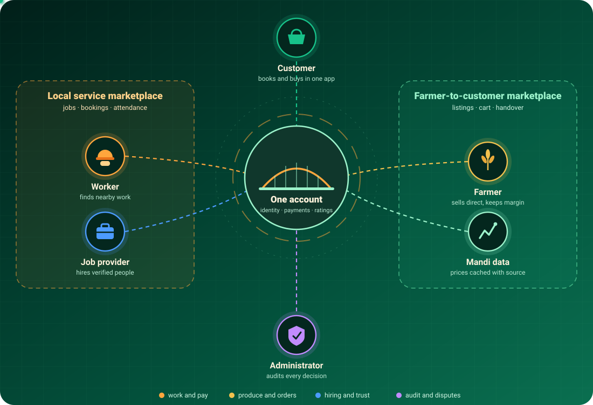


## ✨ 3. Key Features

UdyogaSethu combines employment, service booking, agriculture, verification, payments and AI-powered voice interaction.

### 💼 A. Employment Marketplace

A dedicated platform for workers to discover and apply for employment opportunities.

- Create and manage worker profiles.
- Discover nearby job opportunities.
- View job descriptions, locations and payment details.
- Apply for available jobs.
- Track application and job status.
- Prevent duplicate applications through database-level validation.
- Access digital job tickets for accepted jobs.

### 🛠️ B. Local Service Marketplace

Connects customers with nearby service providers.

- Discover electricians, plumbers, drivers and other service providers.
- Find service providers using location-based search.
- Submit service booking requests.
- Track booking status.
- Access verified worker information.
- Build trust through ratings and reviews.

### 🌾 C. Farmer-to-Consumer Marketplace

Provides farmers with a digital platform to sell their agricultural produce directly to customers.

- Create agricultural produce listings.
- Set product prices and available quantities.
- Update or pause listings.
- Discover nearby agricultural products.
- Add products to a shopping cart.
- Place orders for delivery or pickup.
- Track fulfilment and handover status.

The goal is to reduce unnecessary intermediaries and make local agricultural trade more accessible.

### 📍 D. Location-Based Discovery

Location plays an important role in connecting people with nearby opportunities.

UdyogaSethu uses GPS and PostgreSQL PostGIS to support:

- Nearby job discovery.
- Location-based worker search.
- Proximity-based service discovery.
- Nearby agricultural produce discovery.
- Geographic distance calculations.

### 🛡️ E. Identity Verification and Trust

Trust is essential when people connect with strangers for work, services and transactions.

The platform incorporates:

- Identity verification workflows.
- QR-based digital job tickets.
- Selfie-based attendance verification.
- GPS-based location verification.
- Worker credentials and skill information.
- Ratings and reviews.
- Evidence-based dispute management.

### 💳 F. Wallet and Payment Management

UdyogaSethu integrates a wallet and payment workflow to support transactions.

- Wallet balance management.
- Add-money functionality.
- Transaction records.
- Payment verification.
- Razorpay integration in sandbox mode.
- Server-side payment and order validation.

**Note:** The current implementation uses payment sandbox mode. It does not represent a production payment deployment.

### 🗣️ G. Multilingual AI Voice Assistant

One of the major highlights of UdyogaSethu is its voice-first interaction system.

Instead of requiring users to navigate multiple screens manually, the assistant allows them to interact with the application using spoken commands.

The voice assistant supports eight languages and provides:

- Speech recognition.
- Intent classification.
- Voice-based navigation.
- Context-aware responses.
- Text and spoken answers.
- AI-powered assistance.

The assistant is designed to make the platform more accessible to users who prefer communicating in their own language.

### 🌦️ H. Agricultural Information

The agricultural module provides additional information to support farmers.

- Mandi price information.
- Weather advisories.
- Agricultural information from external data sources.
- Cached fallback information when external services are unavailable.

### 🔔 I. Notifications

Firebase Cloud Messaging supports push notifications for important application events.

Notifications guide users back into the application, where the latest confirmed information is retrieved from the backend.

### 🖥️ J. Admin Dashboard

A separate web-based administration application helps administrators manage platform activities.

It includes:

- User management.
- User verification and review.
- Job and produce listing moderation.
- Payment monitoring.
- Dispute management.
- Audit log management.


## 📱 4. Application Showcase

The following screenshots demonstrate the application interface and its major user workflows.

The application supports three major user groups: workers, farmers and customers.

### 👷 Workers – Find Jobs and Manage Work

Workers can discover nearby opportunities, apply for jobs and manage their work activities.

<table>
<tr>
<td width="50%" align="center">

**Worker Dashboard**

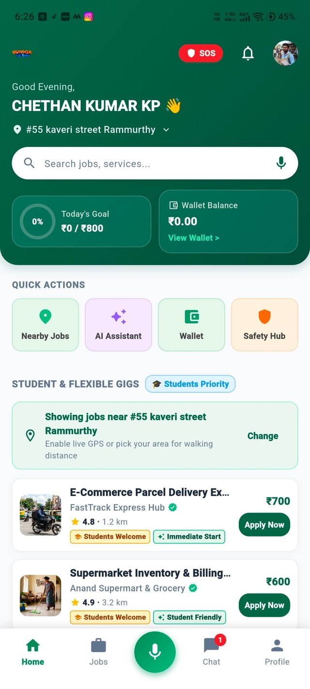

Discover opportunities and access worker services.

</td>
<td width="50%" align="center">

**Nearby Jobs**

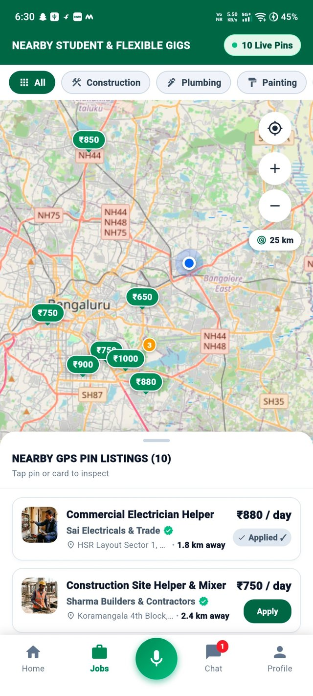

Explore location-based job opportunities.

</td>
</tr>
<tr>
<td width="50%" align="center">

**Digital Job Ticket**

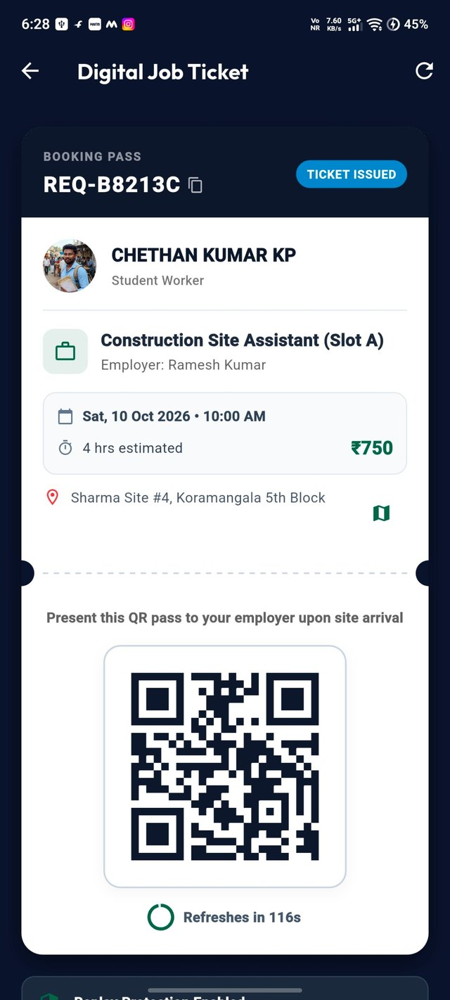

Access a QR-based digital job ticket.

</td>
<td width="50%" align="center">

**Worker Credentials**

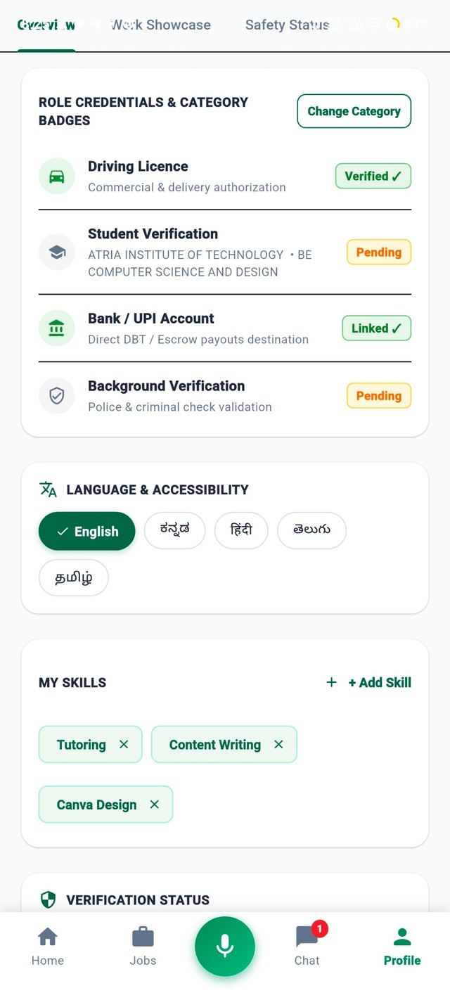

View skills, languages and verification information.

</td>
</tr>
</table>

### 🌾 Farmers – Manage and Sell Produce

Farmers can manage their agricultural profiles and connect with customers through the produce marketplace.

<table>
<tr>
<td width="50%" align="center">

**Farmer Dashboard**

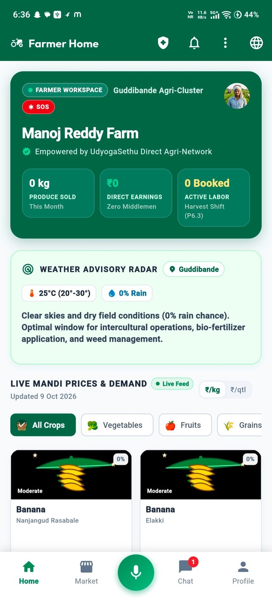

Access agricultural information, weather and mandi prices.

</td>
<td width="50%" align="center">

**Produce Listings**

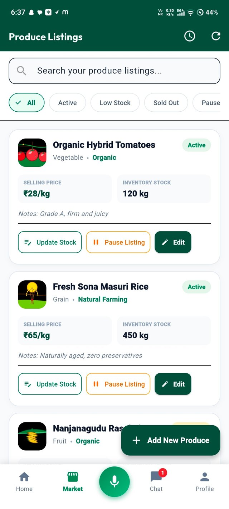

Manage produce prices and available stock.

</td>
</tr>
<tr>
<td width="50%" align="center">

**Farmer Profile**

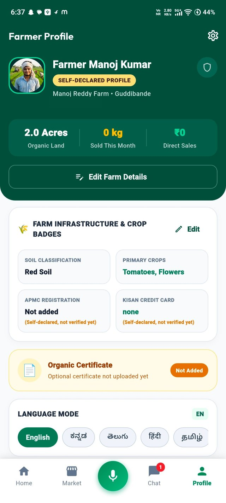

Manage farmer information and profile details.

</td>
<td width="50%" align="center">

**Farm Produce Marketplace**

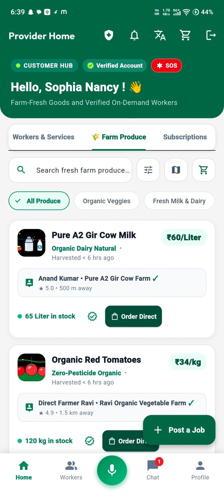

Explore agricultural products available from nearby farms.

</td>
</tr>
</table>

### 🛒 Customers – Discover and Book Services

Customers can access local service providers and agricultural products through a unified interface.

<table>
<tr>
<td width="100%" align="center">

**Customer Dashboard**

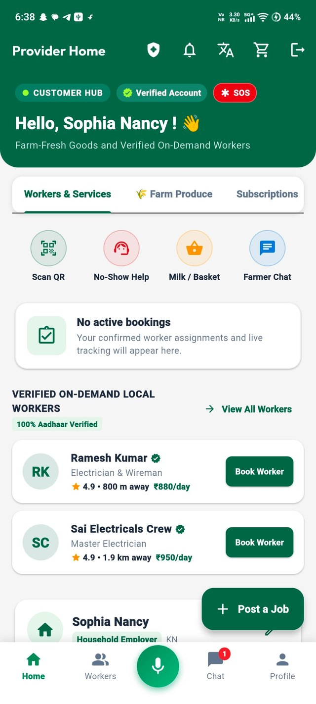

Discover local workers, access services and explore available opportunities.

</td>
</tr>
</table>

### 🎬 Interactive Application Tour

The following animation demonstrates selected screens and workflows from the application.

<div align="center">


</div>

<details>
<summary><b>View application walkthrough GIF</b></summary>

<div align="center">

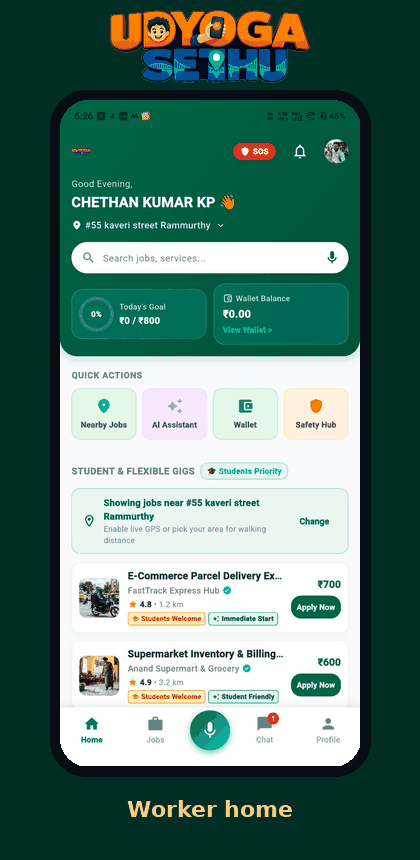

</div>

</details>


## 🔄 5. How the Job Workflow Works

UdyogaSethu follows a structured job lifecycle to ensure that every stage of a job is recorded and validated.

The workflow connects employers, workers and the backend system.


### Job lifecycle

1. **Job Creation:** An employer creates a job with the required details.
2. **Job Discovery:** Workers discover nearby available opportunities.
3. **Application:** Interested workers submit applications.
4. **Selection:** The employer reviews and accepts a suitable applicant.
5. **Job Confirmation:** The backend confirms the job assignment.
6. **Attendance Verification:** The worker checks in using the digital QR ticket, selfie and GPS verification workflow.
7. **Work Completion:** The job progresses through its defined completion stages.
8. **Payment and Review:** Payment status and feedback are recorded through the appropriate workflows.

### 🔐 QR + Selfie + GPS Attendance Verification

A major trust-related feature is the multi-factor attendance verification process.


The system uses three forms of evidence:

- **QR verification:** Confirms the digital job ticket.
- **Selfie verification:** Provides face-based identity evidence.
- **GPS verification:** Helps confirm the worker's location.

The backend evaluates the verification results before accepting attendance.

This approach helps reduce fraudulent check-ins and provides a more reliable record of job participation.

### Backend-confirmed state

An important design principle throughout UdyogaSethu is that **the backend is the source of truth**.

A successful button click or notification is not treated as proof that a transaction or status change has been saved. The application refreshes and displays the state confirmed by the backend.

The agricultural order workflow follows a similar approach:

`Produce Listing → Cart → Order → Fulfilment → Handover → Payment → Review`


## 🎙️ 6. AI-Powered Voice Assistant

The voice assistant is designed to make digital interaction easier for users who prefer speaking rather than navigating complex interfaces.


### How it works

1. **Voice Input:** The user speaks a command in a supported language.
2. **Speech Recognition:** Deepgram processes speech-related input.
3. **Intent Understanding:** The system identifies the user's intention.
4. **AI Processing:** The request is processed using the configured AI providers.
5. **Response Generation:** A relevant response is generated.
6. **Voice Output:** The response is displayed and spoken back to the user.

### AI and voice technologies

| Technology | Purpose |
|---|---|
| Deepgram | Speech recognition and speech-related processing |
| Groq | Primary language-model provider |
| Google Gemini | Multimodal and complex reasoning |
| OpenRouter | Fallback model provider |
| Hugging Face | Intent classification |
| Supabase Edge Functions | Authenticated AI request orchestration |

### Voice assistant safety

The assistant follows important application-level restrictions:

- Navigation is limited to an allow-list of existing application screens.
- Responses are displayed on the screen as well as spoken.
- Spoken commands are not treated as completed database operations until the backend confirms them.
- Permission failures, unsupported languages and network errors are handled with appropriate fallback behaviour.


## 🏗️ 7. System Architecture

UdyogaSethu follows a client-server architecture with a shared backend supporting the mobile application and administration portal.


### Architecture overview

**1. Mobile Application**

The Flutter-based Android application provides the primary interface for workers, farmers and customers.

It handles user interaction, location services, camera operations, QR scanning, voice interaction and application navigation.

**2. Backend Infrastructure**

Supabase provides the shared backend infrastructure, including authentication, database services, storage and realtime capabilities.

**3. Database Layer**

PostgreSQL acts as the primary database, while PostGIS supports geographic queries and location-based discovery.

**4. Server-Side Logic**

Supabase Edge Functions handle authenticated operations, AI orchestration, payment-related workflows and other backend operations.

**5. Administration Portal**

A separate Java and Spring Boot application provides the administrative interface for managing platform activities.

### Core architectural principles

- **Single source of truth:** Important application states are validated and maintained by the backend.
- **Secure authorization:** Row Level Security and server-side validation protect sensitive operations.
- **Separation of responsibilities:** The mobile application and administration portal use separate client-side configurations and access controls.
- **Scalable integration:** External services are integrated through controlled backend workflows.


## 💻 8. Technology Stack

The project combines mobile development, backend services, database technologies, AI integration and cloud infrastructure.

| Category | Technologies |
|---|---|
| Mobile Development | Flutter, Dart |
| State Management | Riverpod |
| Navigation | GoRouter |
| Backend | Supabase |
| Database | PostgreSQL |
| Geospatial Database | PostGIS |
| Authentication | Supabase Auth |
| Serverless Functions | Supabase Edge Functions, TypeScript, Deno |
| Administration Portal | Java 21, Spring Boot 3.3.5, Vaadin Flow 24.4.12 |
| Security | Spring Security, PostgreSQL RLS |
| Voice Recognition | Deepgram |
| AI Integration | Groq, Google Gemini, OpenRouter |
| Intent Classification | Hugging Face |
| Maps and Location | Flutter Map, OpenStreetMap-compatible tiles, Geolocator |
| QR Code | mobile_scanner, qr_flutter |
| Camera and Face Detection | Camera, Google ML Kit |
| Payments | Razorpay Flutter (Sandbox) |
| Notifications | Firebase Cloud Messaging |
| Weather Information | Open-Meteo |
| Agricultural Data | Agmarknet, data.gov.in |
| Android Build | Gradle, R8, ProGuard |
| Dependency Management | Maven, Flutter Pub |


## 🔒 9. Security and Reliability

Security is an important part of a platform that handles identity information, employment activities and financial transactions.

A recent mobile security review addressed eight areas.

| Area | Improvement |
|---|---|
| Biometric Data | Cleared face embeddings, cached photo bytes and stored face data during logout |
| Suspended Accounts | Cleared cached session state to prevent offline session bypass |
| Android Security | Disabled backups and cleartext network traffic |
| Application Logging | Silenced debug logging in release builds |
| Wallet Validation | Added transaction limits and balance validation |
| Edge Function Security | Added security-related HTTP response headers |
| Dependencies | Updated packages and addressed a retracted dependency release |
| Git Hygiene | Expanded ignore rules and removed project-specific values from documentation and examples |

### Security testing results

| Metric | Result |
|---|---:|
| Analyzer Issues | 0 |
| Files Secret-Scanned | 551 |
| Secrets Found in Scan | 0 |
| Security and Widget Tests Passed | 22 |
| Layout Overflow Tests Passed | 33 |

These figures represent results from the project's own audit and test environment.

### Additional production security checks

Before a production deployment, the following still need to be verified:

- Inspect Git history for previously committed credentials and rotate any exposed secrets.
- Verify Row Level Security and backend authorization policies.
- Test authentication and suspended-account handling on real devices.
- Validate payment and AI-provider authentication in the target environment.
- Build, sign and test the Android release artifact.


## 📊 10. Testing and Performance

The project includes functional testing and performance measurements across important application workflows.


### Functional testing

| Metric | Result |
|---|---:|
| Total Functional Test Cases | 50 |
| Passing Test Cases | 47 |
| Not Passing | 3 |
| Pass Percentage | 94% |

### Voice assistant testing

The overall voice intent accuracy was measured at **87.5% across 160 test utterances**.

### Test environment

The measurements were conducted using:

- An Android device.
- Wi-Fi connectivity.
- A Supabase backend.
- Seeded test data consisting of 30 users, 37 jobs and 19 produce listings.
- Sandbox payment integration.

### Understanding the results

These results demonstrate the behaviour of the implemented prototype under the tested conditions.

They should not be interpreted as proof of large-scale production readiness or real-world improvements in worker income, agricultural revenue or employment opportunities.

A field deployment and larger-scale testing would be required to evaluate those outcomes.

### Functional test distribution

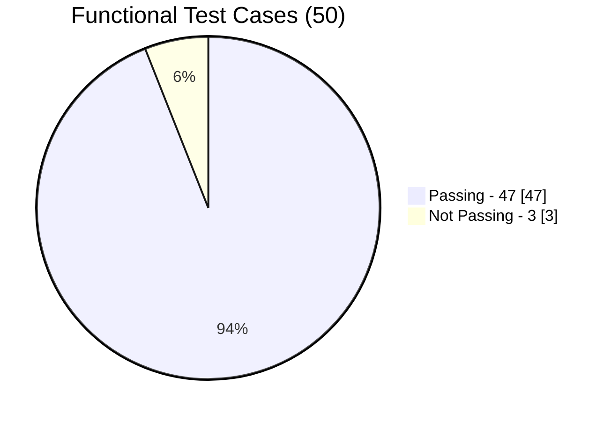


## 🚀 11. Getting Started

Follow these steps to set up the project in your local development environment.

### Prerequisites

Install the following tools:

- Flutter SDK
- Dart SDK
- Android Studio and Android SDK
- Git
- Java Development Kit (JDK 21)
- Maven (for the administration portal)
- A Supabase project
- A Firebase project (for push notifications)

### Step 1: Clone the repository

```bash
git clone https://github.com/chethankp365/UdyogaSethu.git

cd UdyogaSethu
```

### Step 2: Set up the Flutter application

Install the project dependencies:

```bash
flutter pub get
```

Configure your local environment with your own Supabase URL and anon key.

Add the required Firebase configuration file:

```text
android/app/google-services.json
```

This file is intentionally not included in the repository.

Run the application:

```bash
flutter run
```

### Step 3: Configure Supabase Edge Functions

Deploy the required Edge Functions to your Supabase project.

For example:

```bash
supabase functions deploy ai-assist
```

Configure the required provider credentials using Supabase secrets.

Example:

```bash
supabase secrets set GROQ_API_KEY=your_key

supabase secrets set DEEPGRAM_API_KEY=your_key
```

Use your own credentials and configure all required services according to the project environment.

**Important:** Never hardcode service-role keys, AI provider credentials or other privileged secrets inside the mobile application.

### Step 4: Run the administration portal

Navigate to the administration portal project directory.

Run:

```bash
mvn spring-boot:run
```

Ensure that the required database and application configurations are available before starting the portal.

### Configuration notes

- Use your own Supabase project configuration.
- Configure Firebase separately for push notifications.
- Keep sensitive credentials outside version control.
- Production builds must use `DEMO_BUILD=false`.
- Razorpay currently operates in test mode.


## 🛣️ 12. Future Enhancements

UdyogaSethu provides a foundation for an integrated employment and agricultural marketplace. Several improvements are planned for future development.

- [ ] Field deployment with real workers, farmers, employers and customers.
- [ ] Improved job, service and produce recommendation systems.
- [ ] Expanded language support and improved speech recognition across regional accents.
- [ ] Offline access without compromising authentication and security.
- [ ] Stronger liveness detection for face verification.
- [ ] Large-scale performance and load testing.
- [ ] Complete production payment lifecycle.
- [ ] Further evaluation of applicable state gig-worker welfare laws.


## ⚠️ 13. Current Limitations

The current implementation is a research prototype. The following limitations should be considered:

1. Performance measurements are based on seeded data and a relatively small test environment.
2. Payments currently use Razorpay sandbox mode.
3. DigiLocker/eKYC integration is part of the concept and should not be considered a live, production-verified integration.
4. Voice intent accuracy is based on 160 test utterances and does not establish accuracy across all languages, accents and real-world environments.
5. Application screenshots and demonstrations may contain seeded or demonstration data rather than real transactions.
6. Production deployment, field evaluation and large-scale load testing remain future requirements.

These limitations are documented to distinguish implemented prototype functionality from capabilities that require further validation.

---

<div align="center">


### Built with a vision to connect people with opportunities.

**Work. Farm. Voice. Trust.**


### Chethan Kumar KP

[](https://github.com/chethankp365/UdyogaSethu)

<a href="https://github.com/chethankp365/UdyogaSethu">

</a>

</div>
