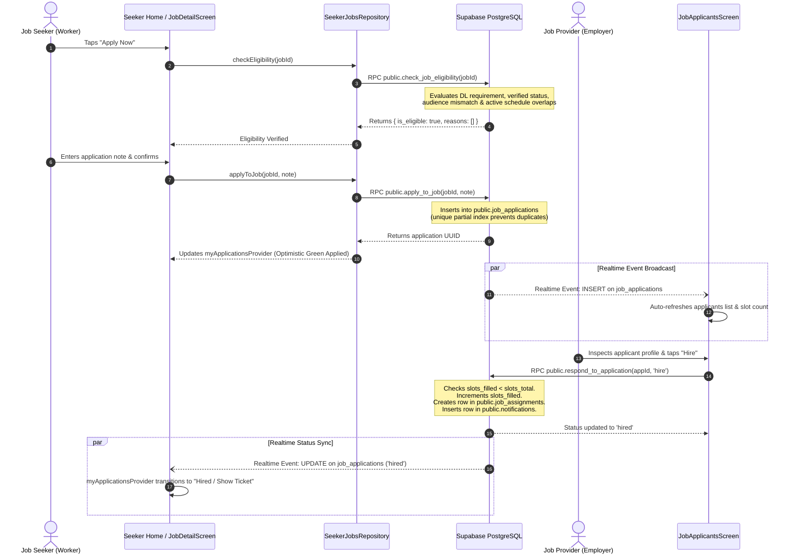
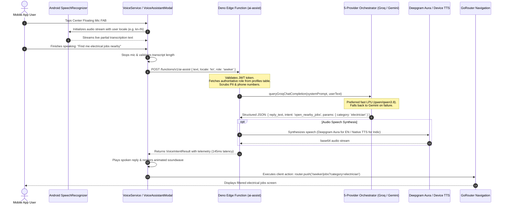
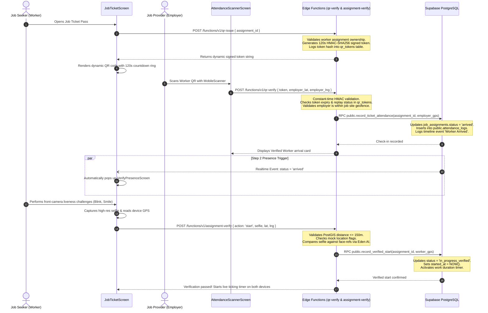
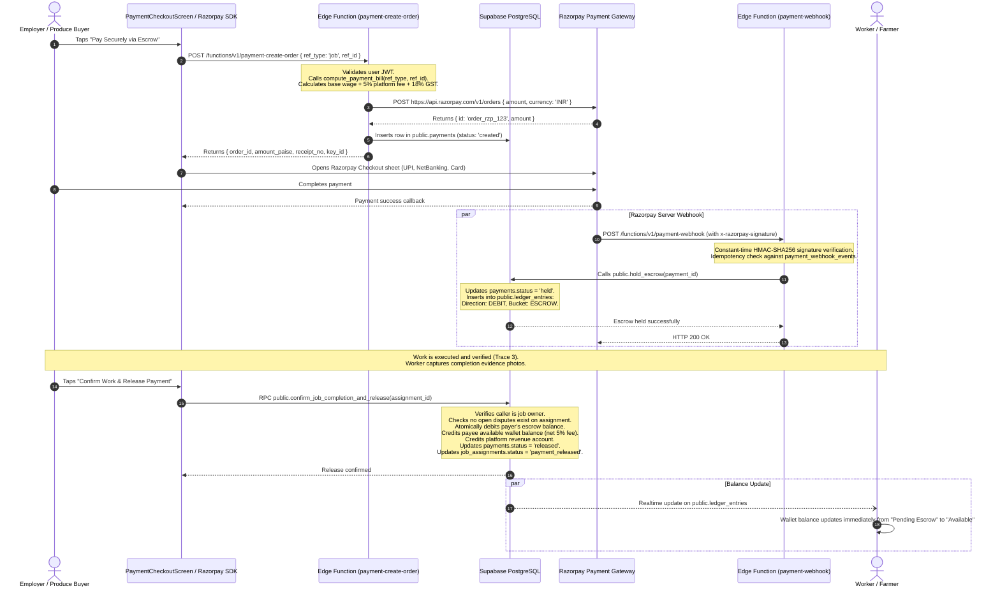

# UdyogaSethu — End-to-End System Architecture & Data Flow

> **Document Version**: 1.0.0  
> **Target Audience**: Technical Architects, Backend Engineers, and Security Auditors  
> **Repository**: `in.udyogasethu.udyogasethu`

---

## 1. Architectural Blueprint & Layered Topology

UdyogaSethu is built using a **Feature-First, Clean Layered Architecture** with strict boundaries between presentation, domain entities, data repositories, and remote cloud infrastructure.

```
┌─────────────────────────────────────────────────────────────────────────────────────────────┐
│                                   LAYER 1: PRESENTATION & UI                                │
│   Screens, Dialogs, Adaptive Bottom Sheets, Touch-Target Widgets, Theme Tokens, Canvas      │
└──────────────────────────────────────────────┬──────────────────────────────────────────────┘
                                               │ Watches & Dispatches Events
                                               ▼
┌─────────────────────────────────────────────────────────────────────────────────────────────┐
│                            LAYER 2: STATE MANAGEMENT & SERVICES                             │
│   Riverpod 3 Notifiers, StreamProviders, LiveLocationService, BootstrapService, Routing    │
└──────────────────────────────────────────────┬──────────────────────────────────────────────┘
                                               │ Invokes Use-Cases / Repository Interfaces
                                               ▼
┌─────────────────────────────────────────────────────────────────────────────────────────────┐
│                               LAYER 3: DATA & REPOSITORY LAYER                              │
│   Plain Dart DTOs, Exception Mapping (AppException), Offline Cache, Realtime Listeners      │
└──────────────────────────────────────────────┬──────────────────────────────────────────────┘
                                               │ HTTPS / WSS / JWT
                                               ▼
┌─────────────────────────────────────────────────────────────────────────────────────────────┐
│                             LAYER 4: BACKEND AS A SERVICE (BaaS)                            │
│   Supabase Auth (GoTrue), PostgREST REST APIs, WebSocket Realtime, Encrypted S3 Storage     │
└───────────────────────┬─────────────────────────────────────────────┬───────────────────────┘
                        │                                             │
                        ▼                                             ▼
┌───────────────────────────────────────────────┐ ┌───────────────────────────────────────────┐
│        LAYER 5: POSTGRESQL & POSTGIS          │ │      LAYER 6: SERVERLESS EDGE FUNCTIONS   │
│  ├── 75+ Tables with 100% RLS Policy Coverage │ │  ├── TypeScript Deno Microservices        │
│  ├── Append-Only Financial Ledger             │ │  ├── Constant-Time Webhook Verification   │
│  ├── Spatial Search (ST_DWithin, GIST)        │ │  ├── 5-Provider AI Assistant Orchestrator │
│  └── Atomic Stored Procedures (PL/pgSQL)      │ │  └── Biometric Comparison (Eden AI)       │
└───────────────────────────────────────────────┘ └─────────────────────┬─────────────────────┘
                                                                        │ External API Calls
                                                                        ▼
                                                  ┌───────────────────────────────────────────┐
                                                  │       LAYER 7: EXTERNAL PLATFORM APIS     │
                                                  │  ├── Groq LPU (Conversational Dialogue)   │
                                                  │  ├── Google Gemini (Multimodal Vision)    │
                                                  │  ├── Deepgram (Neural Voice & Cloud STT)  │
                                                  │  ├── OpenRouter (Multi-Cloud Failover)    │
                                                  │  ├── Eden AI (AWS Rekognition Comparison) │
                                                  │  └── Razorpay India (Payment Gateway)     │
                                                  └───────────────────────────────────────────┘
```

---

## 2. Core Architectural Design Principles

1. **Feature-First Organization**:  
   Code is organized by business feature (`lib/features/<feature>/`) rather than technical role. Each feature strictly encapsulates:
   * `data/`: Repositories, Supabase PostgREST clients, DTOs with `fromJson`/`toJson`.
   * `domain/`: Pure Dart immutable models, enums, calculation helpers, and repository contracts.
   * `presentation/`: Riverpod state notifiers, screens, and micro-widgets.
2. **UI Never Directly Calls Supabase**:  
   Widgets only interact with Riverpod providers and repositories. Raw database calls, JSON parsing, and PostgREST exceptions are trapped in repositories and mapped to typed `AppException` classes.
3. **Single Active Role Policy (D4)**:  
   A user account is strictly bound to one active role (`UserRole.seeker`, `UserRole.provider`, or `UserRole.farmer`). The navigation shell and security guards enforce absolute role segregation.
4. **Server-Authoritative Business Logic & Money**:  
   Client applications never calculate wages, platform fees, or wallet balances. Prices, commissions, and escrow releases are computed inside PostgreSQL stored procedures or Deno Edge Functions using server-held secrets.
5. **Zero-Trust Biometrics & Dynamic Tokens**:  
   Physical attendance requires two independent, cryptographically validated factors: an employer scan of a rotating 120-second signed QR token, followed by a front-camera selfie validated against enrolled face vectors within a 150m PostGIS geofence.

---

## 3. End-to-End Request Tracing (Mermaid Sequence Diagrams)

### 3.1 Trace 1: Submitting a Job Application & Real-time Hiring

The sequence illustrates pre-application eligibility checking, database application creation, real-time sync across devices, employer applicant review, and slot allocation.



---

### 3.2 Trace 2: Voice AI Assistant Query & Intent Routing

This sequence demonstrates speech capture, edge function orchestration across AI vendors, circuit breakers, structured intent parsing, and client-side navigation.



---

### 3.3 Trace 3: Two-Step Verified Attendance Check-in

This sequence outlines the two-factor site check-in flow: an employer dynamic QR code scan followed by worker facial liveness and PostGIS geofencing.



---

### 3.4 Trace 4: Payment Escrow, Completion & Wallet Settlement

This sequence details server-authoritative bill generation, Razorpay checkout, escrow vault locking via webhooks, completed job verification, and double-entry wallet release.



---

## 4. Key Architectural Decisions (ADR Reference)

| Decision ID | Architectural Decision Title | Rationale & Trade-Offs |
| :--- | :--- | :--- |
| **D4** | **ONE ACCOUNT = ONE ROLE Policy** | Eliminates role-switching ambiguity on mobile devices, simplifies RLS security policies, and prevents self-hiring conflicts. |
| **D10** | **Mobile Phone Mandatory for Google OAuth** | Indian gig workers frequently possess multiple Google accounts but only one active mobile number tied to UPI. Mandatory phone OTP eliminates duplicate identities. |
| **D11** | **Append-Only Financial Ledger** | Updating wallet balances via direct row mutation invites race conditions and fraud. `ledger_entries` is strictly append-only; wallet balances are computed dynamically. |
| **D22** | **Server-Computed Payment Bills** | Client-submitted amounts are rejected. `compute_payment_bill` calculates wages, platform commissions, and taxes on PostgreSQL to prevent client-side payment tampering. |
| **D35** | **Zero-Storage DigiLocker Integration** | Masked Aadhaar numbers (`XXXX-XXXX-1234`) and certified names are stored; full raw 12-digit UIDAI numbers are scrubbed from all database rows and logs. |
| **D48** | **Dynamic Rotating QR Attendance Passes** | Fixed QR codes printed on badges invite proxy check-ins. QR tokens rotate every 120 seconds and require HMAC-SHA256 signature verification. |
| **D56** | **Hybrid 5-Provider AI Assistant** | Isolates mobile clients from private AI API keys. Groq provides conversational speed (~100ms), Gemini handles multimodal agro-vision, and OpenRouter offers failover redundancy. |

---

## 5. Document Metadata
* **Author**: Senior Software Architect & Technical Documentation Engineer
* **Verification**: All sequence diagrams and data models mapped directly to working source files in `lib/` and migrations in `supabase/migrations/`.
